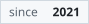

# Meowsica Discord Bot

<p>
  <a href="https://discord.com/api/oauth2/authorize?client_id=909654785156853800&amp;permissions=414568537408&amp;scope=bot">
    <picture><source media="(prefers-color-scheme: dark)" srcset="assets/badges/invite-dark.svg"></picture>
  </a>
</p>
<p>
  <picture><source media="(prefers-color-scheme: dark)" srcset="assets/badges/servers-dark.svg"></picture>
  <picture><source media="(prefers-color-scheme: dark)" srcset="assets/badges/messages-spoken-dark.svg"></picture>
  <picture><source media="(prefers-color-scheme: dark)" srcset="assets/badges/chars-spoken-dark.svg"></picture>
  <picture><source media="(prefers-color-scheme: dark)" srcset="assets/badges/since-dark.svg"></picture>
  <picture><source media="(prefers-color-scheme: dark)" srcset="assets/badges/as-of-dark.svg"></picture>
</p>
<p>
  <picture><source media="(prefers-color-scheme: dark)" srcset="assets/badges/shard-0-dark.svg"></picture>
  <picture><source media="(prefers-color-scheme: dark)" srcset="assets/badges/shard-1-dark.svg"></picture>
  <picture><source media="(prefers-color-scheme: dark)" srcset="assets/badges/shard-2-dark.svg"></picture>
</p>

A Discord text-to-speech bot: it joins your voice channel and reads messages out loud. Built with Bun, TypeScript and discord.js, with Postgres for settings, quota and logs.

Don't want to self-host? Use the button above to invite the hosted bot. It appears on Discord as Google-chan.

## Commands

| Command     | What it does                    |
| ----------- | ------------------------------- |
| `/say`      | Read text out loud              |
| `/join`     | Join your voice channel         |
| `/leave`    | Leave the voice channel         |
| `/skip`     | Skip the current message        |
| `/stop`     | Stop speaking and leave         |
| `/queue`    | Show the messages waiting       |
| `/voice`    | Open the voice settings         |
| `/language` | Change the interface language   |
| `/profile`  | Show your usage and quota       |
| `/help`     | List what the bot can do        |
| `/ping`     | Check how fast the bot responds |

## Disclaimer

This repository is published as-is.
I do not provide troubleshooting or self-host support beyond what is written here.

## Requirements

- Bun 1.2.23 (the version the Dockerfile uses)
- Docker and Docker Compose (recommended)
- Discord application credentials

## Quick start

```bash
cp .env.example .env
docker compose up --build
```

Set at least these environment variables:

- `DISCORD_TOKEN`
- `DISCORD_CLIENT_ID`

Optional: `GOOGLE_CLOUD_API_KEY` enables the Google Cloud TTS voices. The other options are described in `.env.example`.

`DATABASE_URL` is injected automatically by `docker-compose.yml` for the `bot` service. The container also registers the slash commands and applies the database migrations on startup.

## Sharding

Sharding is disabled by default.

Enable it with env flags:

- `ENABLE_SHARDING=true`
- `SHARD_COUNT=auto` (or a positive integer)

Docker example:

```bash
ENABLE_SHARDING=true SHARD_COUNT=auto docker compose up --build
```

## Running without Docker

You need a Postgres database and `DATABASE_URL` set in `.env`.

```bash
bun install
bun run deploy
bun run dev
```

Sharding example:

```bash
ENABLE_SHARDING=true SHARD_COUNT=2 bun run start
```

## Scripts

```bash
bun run start        # normal startup
bun run dev          # startup with reload on file changes
bun run deploy       # register/update slash commands
bun run start:direct # run the bot in a single process, without the sharding manager
```

## Project structure

- `src/index.ts`: app entrypoint, reads env config, boots the app or the sharding manager.
- `src/config/`: loads app config from env.
- `src/bootstrap/`: wiring, startup, shutdown lifecycle.
- `src/features/`: domain features (tts, voice, settings, quota, logs).
- `drizzle/`: SQL migrations; `drizzle.config.ts` configures schema and output.
