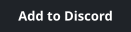
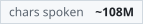
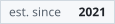
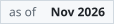
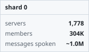
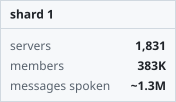
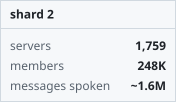

# Meowsica Discord Bot

<p>
  <a href="https://discord.com/api/oauth2/authorize?client_id=909654785156853800&amp;permissions=414568537408&amp;scope=bot">
    <picture><source media="(prefers-color-scheme: dark)" srcset="assets/badges/invite-dark.svg"></picture>
  </a>
</p>
<p>
  <picture><source media="(prefers-color-scheme: dark)" srcset="assets/badges/servers-dark.svg"></picture>
  <picture><source media="(prefers-color-scheme: dark)" srcset="assets/badges/messages-spoken-dark.svg"></picture>
  <picture><source media="(prefers-color-scheme: dark)" srcset="assets/badges/chars-spoken-dark.svg"></picture>
  <picture><source media="(prefers-color-scheme: dark)" srcset="assets/badges/est-since-dark.svg"></picture>
  <picture><source media="(prefers-color-scheme: dark)" srcset="assets/badges/as-of-dark.svg"></picture>
</p>
<p>
  <picture><source media="(prefers-color-scheme: dark)" srcset="assets/badges/shard-0-dark.svg"></picture>
  <picture><source media="(prefers-color-scheme: dark)" srcset="assets/badges/shard-1-dark.svg"></picture>
  <picture><source media="(prefers-color-scheme: dark)" srcset="assets/badges/shard-2-dark.svg"></picture>
</p>

Lightweight Discord bot built with Bun + TypeScript, focused on voice/TTS flows and Postgres-backed settings/quota/log data.

Don't want to self-host? Use the button above to invite the hosted bot. It appears on Discord as Google-chan.

The figures above are updated by hand. Messages and chars spoken are estimates since the 2021 launch; see `scripts/badges.ts`.

## Disclaimer

This repository is published as-is.
I do not provide setup guides, troubleshooting, or self-host support.

## Requirements

- Bun (latest stable)
- Docker + Docker Compose (recommended)
- Discord application credentials

## Quick Start

```bash
cp .env.example .env
docker compose up --build
```

Set at least these environment variables:

- `DISCORD_TOKEN`
- `DISCORD_CLIENT_ID`

`DATABASE_URL` is injected automatically by `docker-compose.yml` for the `bot` service.

## Sharding

Sharding is disabled by default.

Enable it with env flags:

- `ENABLE_SHARDING=true`
- `SHARD_COUNT=auto` (or a positive integer)

Docker example:

```bash
ENABLE_SHARDING=true SHARD_COUNT=auto docker compose up --build
```

## Local (Non-Docker)

If you intentionally run outside Docker:

```bash
bun install
bun run dev
```

Non-Docker sharding example:

```bash
ENABLE_SHARDING=true SHARD_COUNT=2 bun run start
```

## Core Commands

```bash
bun run start        # normal startup
bun run deploy       # register/update slash commands
bun run start:direct # run single process bot entry
```

## Runtime Shape

- `src/index.ts`: app entrypoint, reads env config, boots app or sharding manager.
- `src/bootstrap/`: wiring, startup, shutdown lifecycle.
- `src/features/`: domain features (tts, logs, quota, settings, etc.).
- `drizzle/`: SQL migrations; `drizzle.config.ts` configures schema + output.

## Notes

- App config is loaded from `src/config/index.ts`.
- Sharding is controlled via env flags (`ENABLE_SHARDING`, `SHARD_COUNT`).
